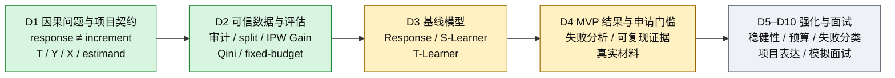
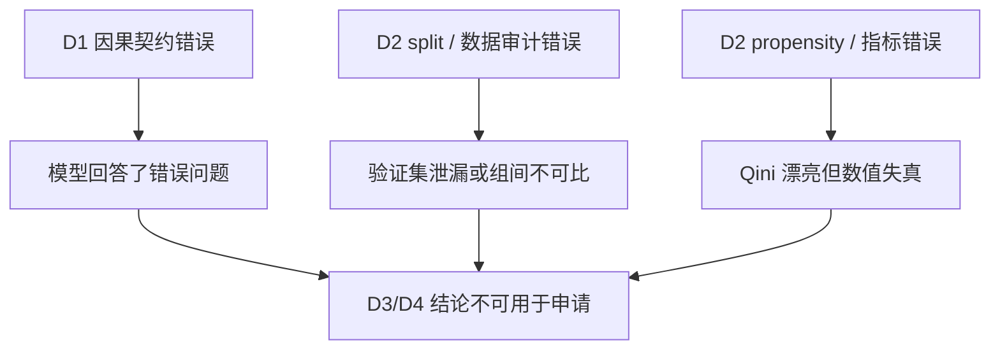
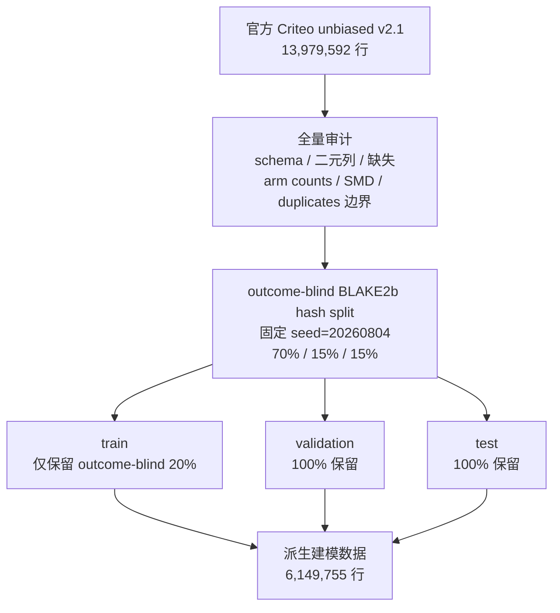
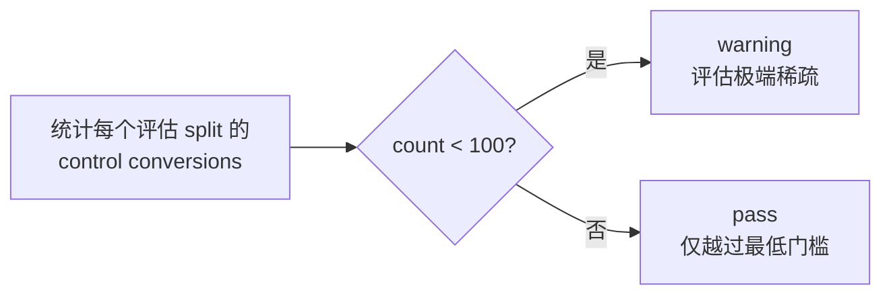
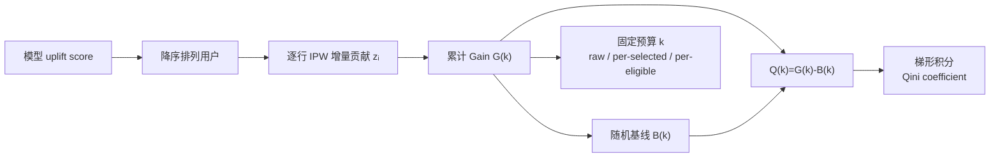
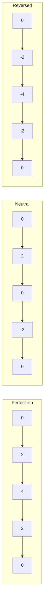
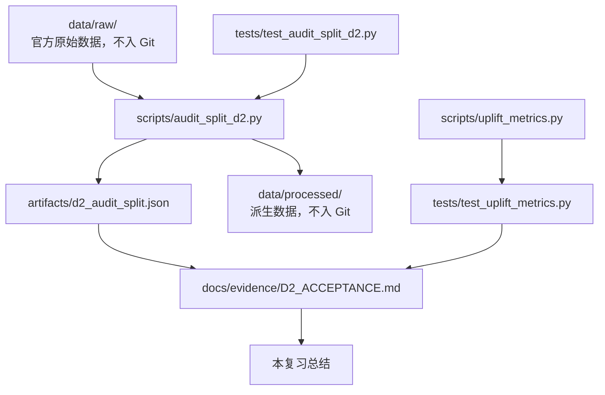
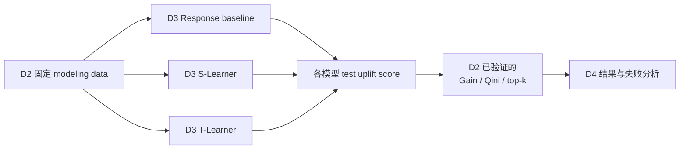

# D2 日包总结：可信数据与 Uplift 评估

| 项目 | 状态 |
|---|---|
| 学习日期 | 2026-08-04 至 2026-08-05 |
| 实际专注时间 | **6h**（只记录 D2 总计，不虚构任务拆分） |
| D2-T1 Data audit and split | `completed / independent_pass` |
| D2-T2 Uplift evaluation | `completed / independent_pass` |
| 自动化验证 | 全套 **18/18** 单元测试通过 |
| 证据边界 | 已有真实 Criteo 数据审计与切分；Qini 仅为合成手算/测试，尚无真实模型结果 |

> 一句话定位：D1 定义“我们要估计什么”，D2 保证“数据与尺子可信”，D3 才开始训练模型。

## 1. D1、D2 在全局任务中的位置



| 阶段 | 核心问题 | 当前真实证据 |
|---|---|---|
| D1：定义问题 | 预测会不会转化，还是预测广告带来的增量？ | 已锁定 Criteo ITT：`T=treatment`、主结果 `Y=conversion`、`X=f0–f11` |
| D2：建立地基 | 数据切分可靠吗？评估尺子量的是什么？ | 已完成全量审计、固定切分、稀有单元 gate 和透明 Uplift 指标测试 |
| D3：训练模型 | response、S-Learner、T-Learner 谁更会把正增量集中到头部？ | **尚未开始** |
| D4：形成证据 | 真实结果、失败分析、复现路径能否进入申请材料？ | **尚未形成模型结论** |
| D5–D10：强化 | 稳健性、成本约束、项目叙事与面试迁移是否过关？ | 后续任务 |

### 为什么 D2 不能跳过



模型越复杂，越不能补救错误的 treatment、outcome、切分或评估定义。

## 2. D1 到 D2：概念接力

| D1 已掌握 | 它在 D2 中产生的直接要求 |
|---|---|
| Response 预测的是 `P(Y=1\|X)`；Uplift 关心 `E[Y(1)-Y(0)\|X]` | 不能用普通 response AUC 代替增量排序评估 |
| 每人只能观察 `Y(1)`、`Y(0)` 中一个 | 不能把某个观测转化者直接标成 persuadable |
| 随机化让处理臂在期望上可比，不是每个特征完全相同 | 用 SMD 和 treatment-prediction 诊断异常，但不要求样本 SMD 精确为 0 |
| `exposure` 是 treatment 之后的变量 | 不把它当普通处理前特征，也不按 exposure 重新定义随机组间因果对比 |
| Criteo 分配约为 85/15 | IPW 必须使用真实/设计 propensity，不能偷换成 0.5 |
| 负 Uplift 人群可能被广告伤害 | 排序评估既要奖励头部正贡献，也要惩罚错误集中的负贡献 |

## 3. D2-T1：数据审计与固定切分

### 3.1 数据流



关键顺序是：**先对全量数据固定分组，再只下采样 train**。这避免 validation/test 中本来就少的 control conversions 被继续稀释。

### 3.2 为什么这样设计

| 设计 | 解决的问题 | 仍未解决的问题 |
|---|---|---|
| outcome-blind hash split | 不看结果分组，减少人为挑选和结果泄漏 | 不能修复源数据本身的偏差 |
| 固定 seed + 稳定 hash | 同一行可重复落入同一 split | 不代表换数据版本后哈希仍相同 |
| 仅下采样 train | 降低训练成本，同时保护评估事件数 | train 方差仍可能变大 |
| validation/test 全保留 | 增加稀有 control conversion 的评估稳定性 | Top-1% 等局部前缀仍可能极稀疏 |
| split 名和臂/结果值使用具名常量 | 减少 `0/1`、tuple 位置等魔法值 | 语义清晰不等于统计假设成立 |

### 3.3 真实审计结果

| 检查项 | 已运行结果 | 正确解释 |
|---|---:|---|
| 原始行数 | 13,979,592 | 全量源数据被审计 |
| 派生建模行数 | 6,149,755 | train 下采样，validation/test 完整保留 |
| `f0–f11` 缺失 | 0 | 当前文件这些字段无缺失；不保证未来日志无缺失 |
| 最大 `\|SMD\|` | 0.048836（`f3`） | 已观测单变量均值未见明显异常；不证明联合/非线性或未观测平衡 |
| validation control conversions | 581 | 高于最低 gate 100 |
| test control conversions | 624 | 高于最低 gate 100 |
| identical rows | 不静默删除 | 无稳定 user ID，无法确认它们是重复单位还是合法同特征用户 |

### 3.4 SMD：它在检查什么

连续特征的标准化均值差可写为：

$$
\operatorname{SMD}(X)=
\frac{\bar X_T-\bar X_C}
{\sqrt{(s_T^2+s_C^2)/2}}
$$


| 看到的现象 | 可以说 | 不可以直接说 |
|---|---|---|
| `max SMD ≈0.049` | 对 `f0–f11` 的单变量均值，未见明显处理前失衡 | “随机化已被证明完美” |
| `f8` 的 SMD 很大（假想题） | 调查分流、过滤、合并、字段时序、偶然失衡 | 直接换 seed 把 SMD 刷低 |
| treatment 能很好被 `X` 预测 | 与简单随机化强烈不一致，应查 leakage/分流链路 | 未调查前就断言唯一原因 |
| treatment 的 exposure 更高 | treatment 可能创造更多曝光机会 | 把 post-treatment exposure 失衡当作处理前随机化失败的直接证据 |

### 3.5 rare-cell gate

定义：validation 和 test 的 **control conversions** 均不得低于 `minimum=100`。



真实输出的核心语义：

| 自描述计数键 | 数值 |
|---|---:|
| `validation_control_conversions` | 581 |
| `test_control_conversions` | 624 |
| `status` | `pass` |

`pass` **只表示整体评估集没有低于预设的极端稀疏底线**，不表示：

- 结果统计显著；
- 估计无偏；
- 模型优于随机；
- Top-1%、Top-5% 等局部前缀事件数充足。

例如 test 全体有 624 个 control conversions，粗略均匀地看 Top-1% 只有约 6 个。只变化 1–2 个事件，局部 uplift 就可能剧烈摆动。

## 4. D2-T2：从 AUC 到 Gain、Qini 与策略价值

### 4.1 每把“尺子”测什么

| 指标 | 问题 | 适合判断 | 不能单独证明 |
|---|---|---|---|
| Response AUC | 转化者是否排在未转化者之前？ | 响应预测排序 | 谁会因广告新增转化 |
| IPW Gain `G(k)` | 前 k 人累计带来多少估计增量？ | 排名头部的 raw 增量 | 个体因果类型标签 |
| Qini 曲线 `Q(k)` | 排序比随机排序多集中多少增量？ | 整条排序的集中能力 | 使用错误 propensity 时自动纠偏 |
| Qini coefficient | `Q(k)` 曲线面积多大？ | 单数值比较排序 | 业务预算下的唯一答案 |
| Top-k / policy value | 预算只触达前 k 人时价值多大？ | 固定预算决策 | 无不确定性的真实线上收益 |

### 4.2 指标计算链



### 4.3 IPW 单行贡献

若 treatment propensity 为 `p=P(T=1)`，二元转化结果为 `Y`：

\[
z_i=\frac{T_iY_i}{p}-\frac{(1-T_i)Y_i}{1-p},
\qquad G(k)=\sum_{i=1}^{k}z_i
\]

| `T` | `Y` | 贡献 `z` | 直觉 |
|---:|---:|---:|---|
| 1 | 1 | `+1/p` | treated conversion 提供正贡献 |
| 1 | 0 | `0` | 本公式中不贡献转化计数 |
| 0 | 1 | `-1/(1-p)` | control conversion 表明无广告也会发生，需扣减 |
| 0 | 0 | `0` | 本公式中不贡献转化计数 |

IPW 用较少出现的实验臂代表更多总体用户。因此 Criteo 的 control 约占 15%，一个 control conversion 的绝对权重大于一个 treated conversion。

### 4.4 四人手算例：完整 Qini 链

设 `p=0.8`，模型排序后的四行贡献为：

| k | 用户类型 | `z_k` | `G(k)` |
|---:|---|---:|---:|
| 0 | 起点 | — | 0 |
| 1 | treated conversion | +1.25 | 1.25 |
| 2 | treated non-conversion | 0 | 1.25 |
| 3 | control conversion | -5.00 | -3.75 |
| 4 | treated conversion | +1.25 | -2.50 |

随机基线定义为：

\[
B(k)=\frac{k}{n}G(n),\qquad Q(k)=G(k)-B(k)
\]

| k | `G(k)` | `B(k)` | `Q(k)` |
|---:|---:|---:|---:|
| 0 | 0 | 0 | 0 |
| 1 | 1.25 | -0.625 | 1.875 |
| 2 | 1.25 | -1.250 | 2.500 |
| 3 | -3.75 | -1.875 | -1.875 |
| 4 | -2.50 | -2.500 | 0 |

x 轴归一化为 `[0,1]`，每段宽度为 `1/4`；y 轴保留 raw IPW gain：

| 梯形区间 | 面积 |
|---|---:|
| 0 → 1 | 0.234375 |
| 1 → 2 | 0.546875 |
| 2 → 3 | 0.078125 |
| 3 → 4 | -0.234375 |
| **Qini coefficient** | **0.625** |

注意：不同库可能改变 x/y 归一化或采用不同 Qini 定义。比较数值前必须同时记录公式，不能只报一个“Qini=多少”。

### 4.5 为什么终点相同仍能比较排序

在合成回归测试中，三种排序都由相同四个人组成，因此 `G(n)` 相同；差异发生在“好贡献是否被集中到头部”。



| 排序 | Gain 形态 | Qini | 含义 |
|---|---|---:|---|
| Perfect-ish | 先升到 4，再回到 0 | +2 | 正贡献集中在头部 |
| Neutral | 围绕基线起伏 | 0 | 没有稳定集中增量 |
| Reversed | 开头先下跌 | -2 | 负贡献被排到头部 |

所以 Qini 评估的不是终点总增量，而是模型把优质资源集中到排名头部的能力。

### 4.6 固定预算的三个口径

假设 eligible 用户 `n=100,000`，只触达前 `k=10,000`，且 `G(k)=180`：

| 口径 | 公式 | 数值 | 业务解释 |
|---|---|---:|---|
| raw incremental gain | `G(k)` | 180 | 对前 k 人的累计估计增量转化 |
| per-selected uplift | `G(k)/k` | 1.8pp | 每位被选用户平均增量 |
| per-eligible policy value | `G(k)/n` | 0.18pp | 摊到全体 eligible 用户的平均策略价值 |

`G(k)=180` 不表示识别出了 180 个确定的 persuadable。它是多种潜在人群与抽样噪声混合后的 IPW 宏观净增量估计。

### 4.7 propensity 不能写错

| 权重 | 正确 `p=0.85` | 错误 `p=0.5` |
|---|---:|---:|
| treated conversion | `1/0.85 ≈ +1.176` | `+2.000` |
| control conversion | `-1/0.15 ≈ -6.667` | `-2.000` |

误用 0.5 会同时：

1. 高估 treated conversion 的正贡献；
2. 严重低估 control conversion 的负贡献；
3. 扭曲 `G(k)` 和终点 `G(n)`；
4. 继而扭曲 `B(k)=kG(n)/n` 与 `Q(k)`。

`Q(n)=0` 只是构造上的终点相等，不能让错误 propensity 自动抵消。

## 5. 代码、数据与证据地图



| 证据 | 位置 | 状态 |
|---|---|---|
| 审计、split、rare-cell 实现 | `scripts/audit_split_d2.py` | 已运行 |
| Gain/Qini/policy value 实现 | `scripts/uplift_metrics.py` | 合成数据已验证 |
| D2 边界测试 | `tests/test_audit_split_d2.py`、`tests/test_uplift_metrics.py` | 全套项目测试 18/18 |
| 真实审计 JSON | `artifacts/d2_audit_split.json` | 已生成 |
| 派生建模数据 | `data/processed/criteo_modeling_data.csv.gz` | 已生成，6,149,755 行 |
| 验收证据 | `docs/evidence/D2_ACCEPTANCE.md` | 已关闭 D2 |

固定校验值：

| 文件 | SHA-256 |
|---|---|
| 派生 gzip | `917f3387de981af74349924ecf7e94331f9b603d21eb1a81a4bc9f6843098f51` |
| 审计 JSON | `5254043c948fed3e199bfa7409c00f62c1415847f60fa389f6d58dbfb6b147e8` |

## 6. 已完成证据与未来研究必须分开

| 可以作为“已完成”陈述 | 目前不能作为“已完成”陈述 |
|---|---|
| 全量 Criteo 数据审计 | 已训练 response model |
| 固定、outcome-blind 的 split | 已训练 S-Learner/T-Learner |
| validation/test 完整保留 | 已得到 Criteo 模型预测 |
| 处理前特征 SMD 与 rare-cell gate | 某模型在真实 Criteo 上 Qini 最优 |
| IPW Gain/Qini 的手算和合成回归测试 | 已画真实模型 Gain/Qini 曲线 |
| 全套 18/18 测试通过 | 已得到可写入简历的模型效果结论 |

申请材料中，“未来计划尝试某方法”属于 prospective research idea；它不能被改写成“项目已经验证某方法有效”。

## 7. 高频错误复习表

| 常见错误 | 为什么错 | 正确动作 |
|---|---|---|
| 用 response AUC 选 uplift 模型 | 转化概率高不等于处理增量高 | 使用 Gain/Qini 与预算策略指标 |
| 删除所有相同匿名行 | 没有 user ID，无法识别重复单位 | 记录不可识别边界，调查来源 |
| 删除差异性 outcome 缺失行后直接比转化率 | 删除可能破坏随机可比性 | 分 arm 查缺失机制和日志链路 |
| 看到 SMD 非 0 就换 seed | 有限样本本来会波动，换 seed 会引入结果挑选 | 固定设计，调查异常来源并如实报告 |
| `rare_cell_check=pass` 就宣称显著 | gate 只是最低事件数防呆 | 检查 top-k 局部 counts 和不确定性 |
| Criteo propensity 一律写 0.5 | 真实分配约 85/15 | 从设计/数据契约读取并验证 p |
| 只报 Qini 数字 | 不同实现归一化可能不同 | 同时报公式、基线和 x/y 口径 |
| 将 `G(k)` 当 persuadable 人数 | 个体反事实不可同时观测 | 称为 IPW 宏观净增量估计 |

## 8. 面试快速检索卡

| 问题 | 30 秒答案 |
|---|---|
| 为什么不用普通 AUC？ | AUC 衡量转化者排序，而项目目标是把因广告产生的增量集中在预算头部；两者目标不同。 |
| 为什么 control conversion 权重为负？ | 它代表没有广告也会发生的转化，估计增量时需从 treated 结果中扣除；control 较少，所以 IPW 绝对权重大。 |
| Qini 为什么看整条曲线？ | 相同用户集合的终点可以相同，但业务只触达头部；曲线衡量正增量是否提前集中。 |
| SMD 小能证明随机化吗？ | 不能。它只支持已观测特征的特定平衡诊断，不覆盖未观测、联合、非线性或数据链路错误。 |
| rare-cell pass 能证明什么？ | 只证明 validation/test 整体 control conversions 没低于人为设定的最低门槛，不能证明显著、无偏或 top-k 稳定。 |
| D2 最大产出是什么？ | 建立固定、可复现的数据入口和透明评估契约，让 D3 的模型比较不会因 split 或指标偷换而失真。 |

## 9. D3 如何消费 D2 产物



D3 必须保持以下不变量：

- 不重新抽 split、不为了结果更好而换 seed；
- validation 用于选择，test 保持最终评估角色；
- 不将 `exposure` 或 outcome 泄漏进特征；
- 使用真实 propensity，并记录指标约定；
- 每个 Top-k 同时报 arm/outcome 局部计数或不确定性；
- 只有真实运行的模型结果才能进入 D4 与申请材料。

当前技术风险：D2 结束时，本地 Python 3.12 环境中的第三方数值/建模包仍未确认可导入。D3 开始时应先透明解决或采用可解释回退，不得假装模型已运行。

## 10. 复现检查

```bash
cd /Users/hx/dev/work2/causal-uplift-project
python3 -m unittest discover -s tests -v
python3 scripts/audit_split_d2.py --confirm-plan
gzip -t data/processed/criteo_modeling_data.csv.gz
```

预期：测试全部通过；审计/split 契约不变；gzip 完整。不同环境重新压缩时 gzip 字节级哈希可能受元数据影响，因此还应核对行数、schema、split counts 与审计 JSON，而不是孤立依赖一个哈希。
